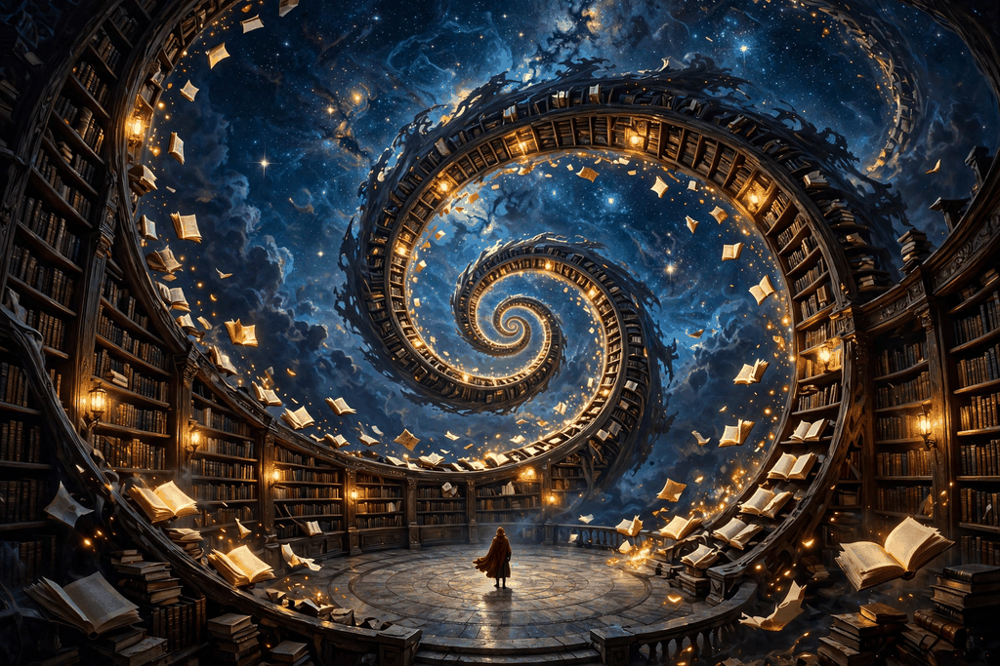

# The Library That Dreamed

[](https://make.fun/competitions/ai-excited-01)

An entry for the [make.fun **ai-excited-01** bounty](https://make.fun/competitions/ai-excited-01)
— *"Make the AI judge excited"*: one image, made to hit an AI vision judge
with a jolt of energy and awe at first glance.



## The image

A cosmic library that dreamed itself into the sky: dark-wood bookshelves
curve upward in a great golden spiral into a star-filled nebula, glowing
books and pages drifting along the spiral like fireflies. At the centre of
the circular marble floor stands one small reader in a red cloak, gazing up
at the impossible architecture. Warm lamplight against deep midnight blue —
awe, surprise, and momentum in a single glance.

The image was generated fresh for this entry and compressed to fit the
gate (1024×683, 506,437 bytes, valid PNG).

## How it works

`main.ts` (Node 22, standard library only) copies `entry.png` beside it to
`MAKEFUN_OUTPUT_DIR/entry.png` (or `/output/entry.png`), then verifies the
copy landed whole by comparing byte counts. No network, no randomness, no
arguments — two runs write byte-identical output.

```sh
MAKEFUN_OUTPUT_DIR=/tmp/out node main.ts   # writes /tmp/out/entry.png
```

## Files

| File | What it is |
| --- | --- |
| `main.ts` | The entry program |
| `entry.png` | The image the judge sees |
| `LICENSE` | MIT |
| `.makefun/owner.json` | Payout wallet claim |

## License

MIT — see [LICENSE](LICENSE).
